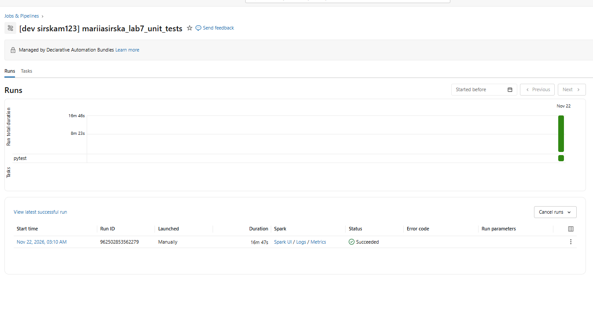
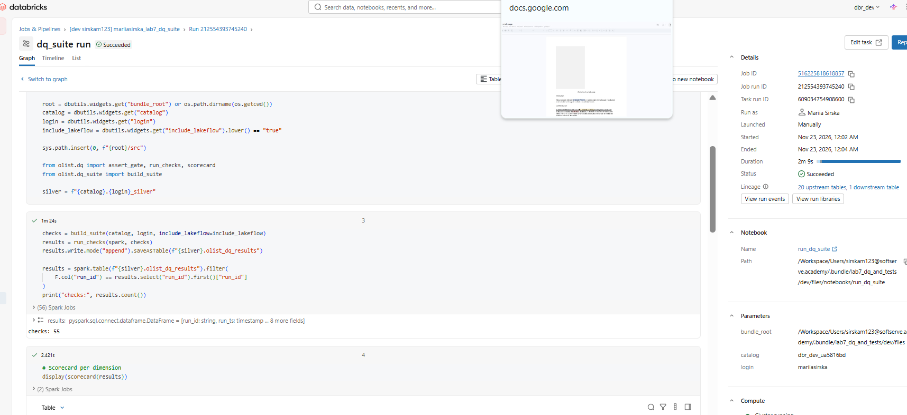
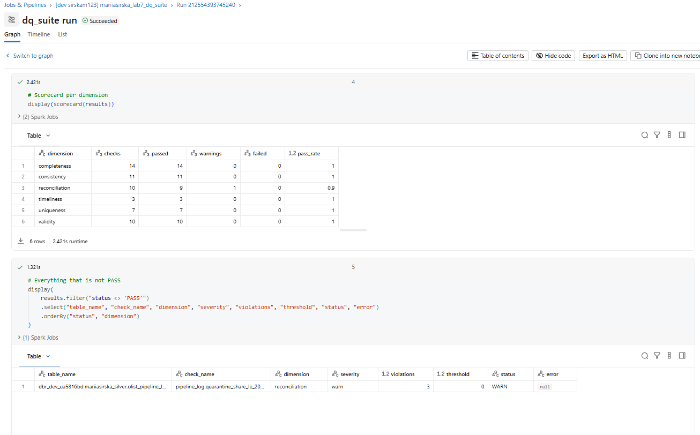
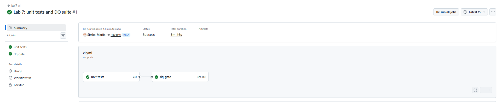
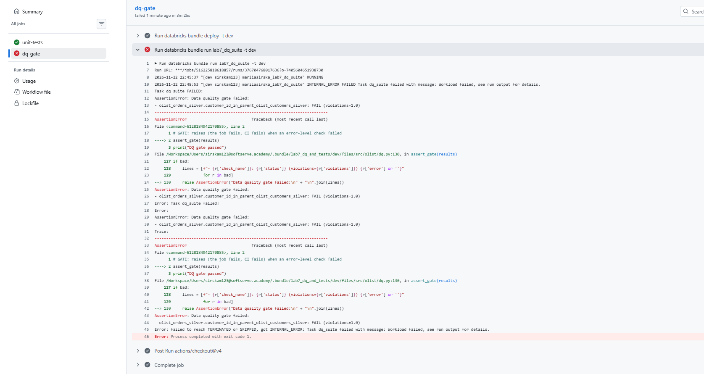
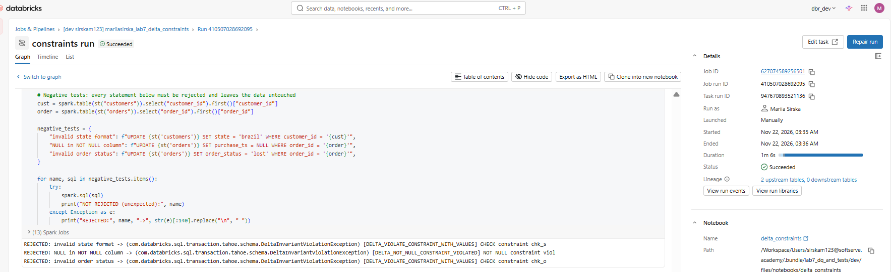
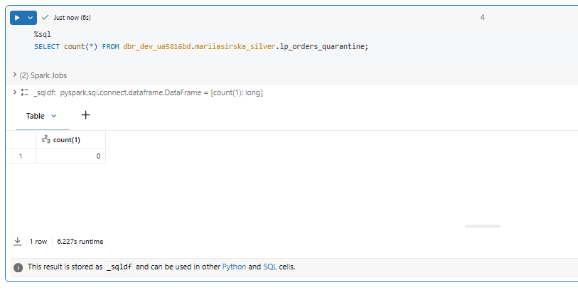

# Lab 7. Unit tests and data-quality testing (Olist medallion)

```
lab7/
├── databricks.yml              bundle: jobs lab7_unit_tests and lab7_dq_suite
├── pytest.ini
├── src/olist/
│   ├── transforms.py           pure transformation functions (the refactored Lab 4 logic)
│   ├── dq.py                   DQ framework: Check, builders, runner, gate, scorecard
│   └── dq_suite.py             the checks across bronze / silver / Lakeflow gold
├── tests/                      pytest (conftest picks the Spark session automatically)
├── notebooks/                  run_unit_tests, run_dq_suite, delta_constraints
└── lakeflow_quarantine_snippet.py
```
bundle_run_unit_tests_success:


bundle_run_dq_suite_success:


dq_scorecard_and_non_pass:


Databricks connect session:


Pytest local, 39 tests passed:


ci_green:





Delta constraints reject invalid writes:


lakeflow_quarantine_table:


## Databricks Connect
1. Python version must match the cluster runtime.
2. New venv, then install the package for your DBR (do NOT install pyspark next to it):
   ```
   python -m venv .venv
   .venv\Scripts\activate
   pip install pytest "databricks-connect==15.4.*"
   ```
3. Authenticate and bind the cluster: `databricks auth login --host <url> --profile lab`, then add
   `cluster_id = <cluster id>` under `[lab]` in `~/.databrickscfg` (or set `DATABRICKS_CLUSTER_ID`), and
   `$env:DATABRICKS_CONFIG_PROFILE = "lab"`.
4. Check: `python -c "from databricks.connect import DatabricksSession as S; print(S.builder.getOrCreate().range(3).collect())"`
5. Run: `pytest -v`. In VS Code: Testing panel -> debug a test with breakpoints.

## Headless runs
```
databricks bundle validate
databricks bundle deploy -t dev
databricks bundle run lab7_unit_tests -t dev     # pytest on the cluster
databricks bundle run lab7_dq_suite -t dev       # DQ suite + gate (non-zero exit code on failure)
```
Local Spark without a cluster (CI): `USE_LOCAL_SPARK=1 pytest -v` (needs Java and `pip install pyspark==3.5.3`).
